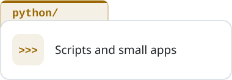
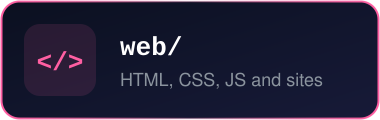
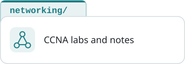

  

  
  &nbsp;&nbsp;
  
  &nbsp;&nbsp;
  

  
    
  
    
  

    Hi, I'm Georgy, a junior developer from Portugal, currently an Erasmus+ intern in Cork, Ireland. 
    I have CCNA and cybersecurity foundations, and I work with Java, Python, Android, web, and networking/security.
  

  

    This repo is my learning notebook: short notes and mini-projects that show what I've actually built and learned, as I go. 
    It's a record of progress, not a showcase of finished products.
  

  
    
  
  
  
   
  
  
  
    
  
Every entry follows the same template in <a href="templates/entry.md"><code>templates/entry.md</code></a>: what I built, what I learned, and the tools I used.

  
  
Newest first.

<table align="center">
  <tr><th>Date</th><th>Entry</th><th>Area</th></tr>
  <tr><td>2026-10-20</td><td><a href="python/2026-10-20-a-paper-trading-app-with-an-honest-ml-signal.md">A paper trading desktop app with an honestly tested machine-learning signal</a></td><td></td></tr>
  <tr><td>2026-10-19</td><td><a href="android/2026-10-19-screen-readers-and-two-languages-in-an-android-app.md">Making an Android app work with a screen reader and in two languages</a></td><td></td></tr>
  <tr><td>2026-10-19</td><td><a href="android/2026-10-19-dark-theme-for-an-existing-android-app.md">Adding a dark theme to an existing Android app</a></td><td></td></tr>
  <tr><td>2026-10-19</td><td><a href="security/2026-10-19-protecting-sign-in-from-bots-with-a-captcha.md">Protecting sign-up and sign-in from bots with a captcha</a></td><td></td></tr>
  <tr><td>2026-10-16</td><td><a href="security/2026-10-16-triaging-security-risks-across-projects.md">Triaging security risks against how each project is built</a></td><td></td></tr>
  <tr><td>2026-10-15</td><td><a href="security/2026-10-15-securing-an-app-backend-before-release.md">Securing an app's backend before release</a></td><td></td></tr>
  <tr><td>2026-10-15</td><td><a href="android/2026-10-15-online-payments-with-stripe-connect.md">Online payments in an Android app with Stripe Connect</a></td><td></td></tr>
  <tr><td>2026-10-13</td><td><a href="python/2026-10-13-a-small-data-app-with-streamlit-and-sqlite.md">A small data app with Python, SQLite and Streamlit</a></td><td></td></tr>
  <tr><td>2026-10-13</td><td><a href="web/2026-10-13-editorial-redesign-of-a-product-page.md">Art-directing a product page around typography and real screenshots</a></td><td></td></tr>
  <tr><td>2026-10-13</td><td><a href="android/2026-10-13-free-push-notifications-for-an-android-app.md">Free push notifications for an Android app</a></td><td></td></tr>
  <tr><td>2026-10-12</td><td><a href="android/2026-10-12-finding-why-an-android-app-feels-slow.md">Finding out why an Android app feels slow</a></td><td></td></tr>
  <tr><td>2026-10-09</td><td><a href="web/2026-10-09-animated-landing-page-that-stays-fast.md">An animated product landing page that stays fast</a></td><td></td></tr>
  <tr><td>2026-10-07</td><td><a href="android/2026-10-07-securing-and-modernising-an-android-firebase-app.md">Securing and modernising an Android + Firebase app</a></td><td></td></tr>
  <tr><td>2026-10-06</td><td><a href="web/2026-10-06-interactive-course-and-exam-integrity.md">Interactive lessons and a fair exam system for an online course</a></td><td></td></tr>
  <tr><td>2026-10-01</td><td><a href="web/2026-10-01-secure-learning-platform.md">Sign-in, payments and security for a learning platform</a></td><td></td></tr>
</table>
